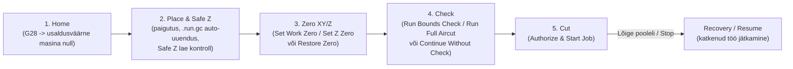
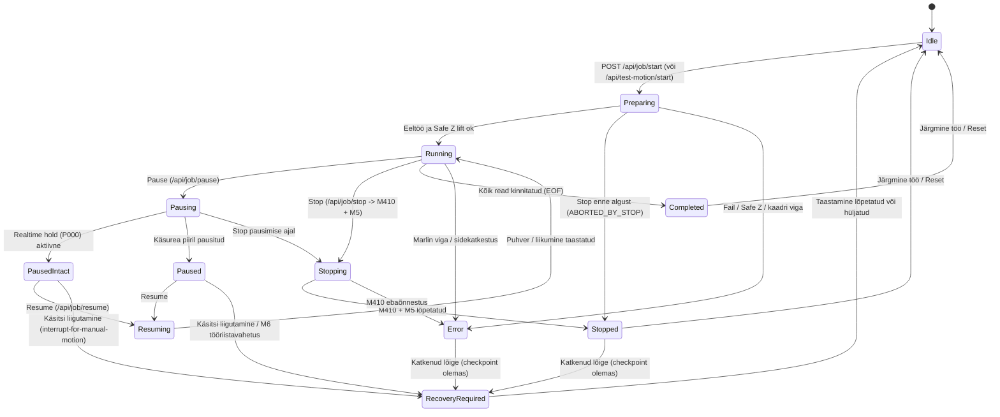
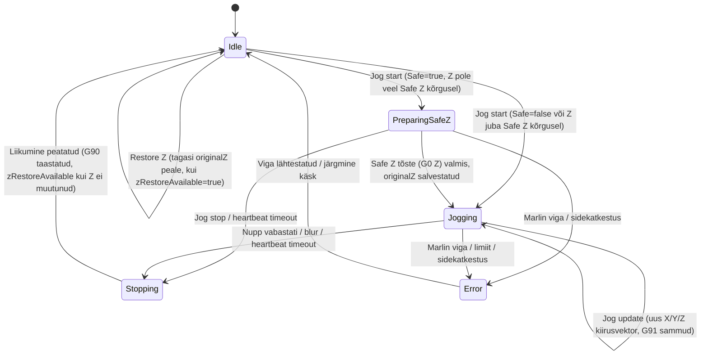
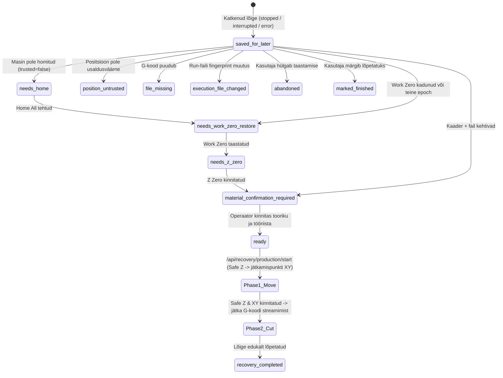
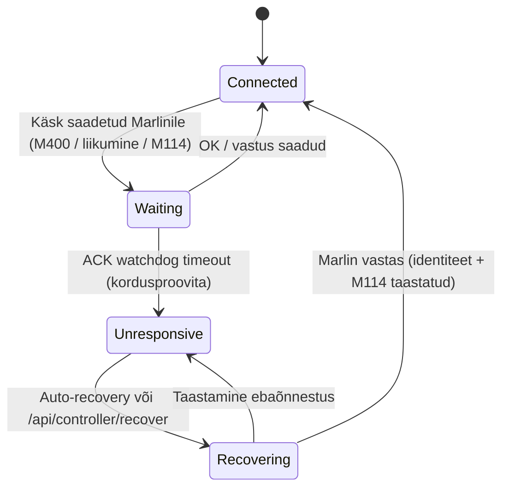
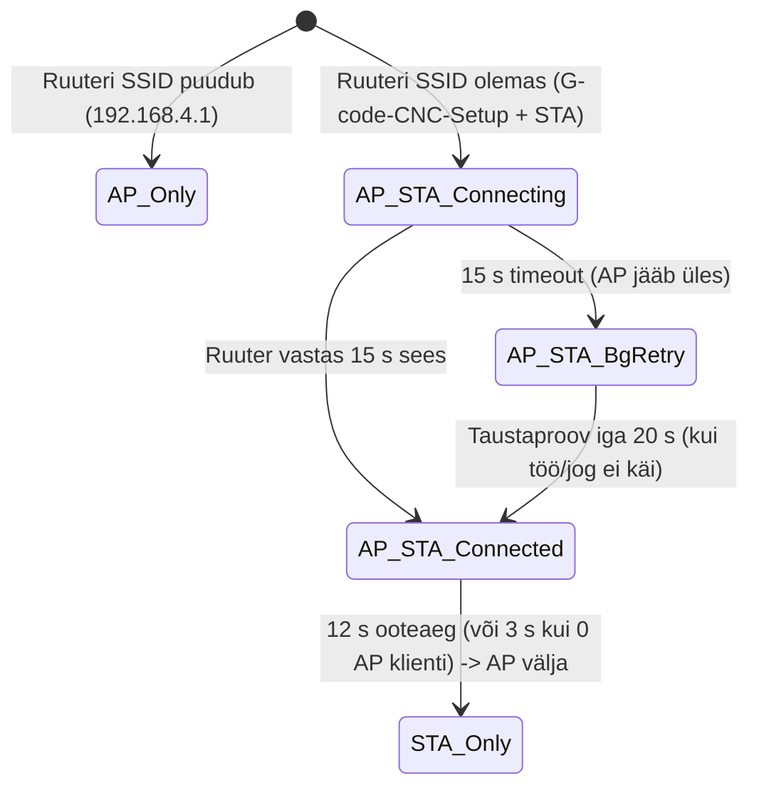

# CNC-ESP32 protsesside olekumasinad

Süsteemi põhiprotsesside olekumasinad tegeliku koodi põhjal ([src/main.cpp](../src/main.cpp), [www/preview.js](../www/preview.js), [www/machine-bar.js](../www/machine-bar.js), [www/lib/job-readiness.js](../www/lib/job-readiness.js), [www/lib/job-recovery.js](../www/lib/job-recovery.js)).

---

## 1. Töövoog UI-s (`Job Readiness` 5 sammu)

---

## 2. Töö mootori olekumasin (`JobRunnerState` — `src/main.cpp`)

---

## 3. Joggingu olekumasin (`JogState` — `src/main.cpp`)

---

## 4. Katkenud töö taastamine (`Recovery` — `www/lib/job-recovery.js` & `src/main.cpp`)

---

## 5. Kontrolleri side ja taastamine (`ControllerCommunicationState`)

---

## 6. Wi-Fi käivitus ja taustaühendus (`AP + STA`)

